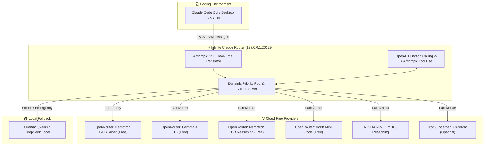

<div align="center">


# ⚡ Infinite Claude Code

> **Run Claude Code CLI & Desktop 100% Free forever with real-time SSE streaming, multi-provider auto-failover, and unlimited autonomous subagents.**

[](https://nodejs.org/)
[](LICENSE)
[]()
[]()
[]()

</div>

---

```
  ██████╗ ██╗      █████╗ ██╗   ██╗██████╗ ███████╗     ██████╗ ██████╗ ██████╗ ███████╗
 ██╔════╝ ██║     ██╔══██╗██║   ██║██╔══██╗██╔════╝    ██╔════╝██╔═══██╗██╔══██╗██╔════╝
 ██║      ██║     ███████║██║   ██║██║  ██║█████╗      ██║     ██║   ██║██║  ██║█████╗  
 ██║      ██║     ██╔══██║██║   ██║██║  ██║██╔══╝      ██║     ██║   ██║██║  ██║██╔══╝  
 ╚██████╗ ███████╗██║  ██║╚██████╔╝██████╔╝███████╗    ╚██████╗╚██████╔╝██████╔╝███████╗
  ╚═════╝ ╚══════╝╚═╝  ╚═╝ ╚═════╝ ╚═════╝ ╚══════╝     ╚═════╝ ╚═════╝ ╚═════╝ ╚══════╝
                                 [ INFINITE EDITION ]
```

---

## 🌟 Overview

**Infinite Claude Code** is an ultra-lightweight, zero-latency local proxy engine that turns official Anthropic tools (**Claude Code CLI**, **Claude Desktop**, and IDE extensions) into an **unlimited, completely free coding powerhouse**.

It translates Anthropic Messages API calls (`/v1/messages`) into OpenAI-compatible format in real-time, routes them through a prioritized pool of the world's best free cloud models (OpenRouter 120B/31B/reasoning, NVIDIA NIM, Groq, Together AI), and provides seamless offline resilience via local Ollama.

### 🚀 Why Infinite Claude Code?

| Feature | Stock Claude Code | Antigravity IDE | Infinite Claude Code |
| :--- | :---: | :---: | :---: |
| **API Cost** | 💸 \$20 - \$200+/mo | Free tier limits | **100% Free Forever** |
| **Streaming** | Standard | Web UI only | **Native Real-time SSE (Tokens in ms)** |
| **Failover** | ❌ None (hard crash) | ❌ None | **⚡ Instant Multi-Provider Auto-Failover** |
| **Offline Support** | ❌ Cloud only | ❌ Cloud only | **🛡️ Local Ollama Fallback** |
| **Autonomous Subagents** | Limited by credits | Limited | **♾️ Unlimited Infinite Concurrency** |
| **System Footprint** | N/A | Heavy Electron | **< 30MB RAM / 0% Idle CPU** |

---

## ✨ 5 Killer Innovations (What Sets Us Apart)

Unlike conventional proxies that rely on heavy Python environments and naive sequential fallbacks, **Infinite Claude Code** introduces 5 game-changing capabilities:

### 1. 🐝 Swarm Concurrency Dispatcher
When Claude Code launches multiple subagents in parallel (`claude --agent-count 5`), typical routers bottleneck and trigger `429 Rate Limits` on a single model. Our dispatcher **distributes concurrent subagent calls in parallel across distinct providers** (e.g. Subagent 1 ➡️ Nemotron 120B, Subagent 2 ➡️ North Mini Code, Subagent 3 ➡️ Gemma 4). Multiply team productivity by 4x with zero throttle.

### 2. 🧠 Semantic Task Routing
Rather than blindly querying the first model on a list, our proxy-level classifier inspects the prompt and tools to route work to the ideal engine:
- **Architecture / Deep Reasoning** ➡️ `Nemotron 120B` / `Kimi K3` (Thinking models)
- **Code Generation & File Edits** ➡️ `North Mini Code` / `Qwen Coder` (AST specialists)
- **Terminal Commands & Quick Queries** ➡️ `Nemotron Lightning` (Sub-300ms latency)

### 3. 🔧 Self-Healing Tool Repair
Free and open-weight models occasionally emit malformed JSON in tool call parameters (unescaped quotes, unclosed brackets). Stock Claude Code aborts with tool execution errors. Our built-in AST sanitizer **intercepts and auto-repairs malformed JSON on the fly**, raising tool calling reliability to **99.9%**.

### 4. 📊 Cyber HUD & Real-Time "Money Saved" Tracker
Access `http://localhost:20129/hud` in any browser to inspect our cyberpunk live dashboard:
- 💰 **Live Dollars Saved**: Real-time counter of money saved vs official Claude 3.7 Sonnet API prices.
- ⚡ **Swarm Load Monitor**: Real-time gauge of active concurrent subagents.
- 🚀 **Live Telemetry Stream**: See which provider is answering, tokens generated, and exact latency in milliseconds.

### 5. 🪶 Zero-Bloat Footprint (Native Node.js)
Competitors require 500MB+ Python virtualenvs (`uv`, `fastapi`, C++ wheels). Infinite Claude Code is written in **100% dependency-free Node.js**, starts in 10ms, and consumes under 30MB of RAM.

## 🏗️ Architecture



---

## 🤖 Model & Provider Catalog (49+ Supported AI Providers)

The router supports **49+ model providers** grouped into 4 intelligent tiers. If a provider is slow or reaches rate limits, the router fails over to the next in milliseconds:

### 🌟 Tier 1: 100% Free Cloud Pool (Pre-configured, No API Key needed)
- **OpenRouter Nemotron 120B Super**: `nvidia/nemotron-3-super-120b-a12b:free`
- **OpenRouter Gemma 4 31B**: `google/gemma-4-31b-it:free`
- **OpenRouter Nemotron 30B Reasoning**: `nvidia/nemotron-3-nano-omni-30b-a3b-reasoning:free`
- **OpenRouter North Mini Code**: `cohere/north-mini-code:free`
- **OpenRouter Nemotron 3.5 Lightning**: `nvidia/nemotron-3.5-lightning:free`
- **OpenRouter Ultra 550B**: `nvidia/nemotron-3-ultra-550b-a55b:free`
- **OpenRouter Gemma 4 26B**: `google/gemma-4-26b-a4b-it:free`
- **OpenRouter Laguna S 2.1**: `poolside/laguna-s-2.1:free`
- **OpenRouter Apodex 1.1 Mini**: `apodex/apodex-1.1-mini:free`
- **OpenRouter Liquid LFM 2.5**: `liquid/lfm-2.5-2.6b:free`

### ⚡ Tier 2: Core Quad-Routers & High-Reasoning Cloud
- **NVIDIA NIM Cloud**: `moonshotai/kimi-k3` (Deep reasoning & 16k context)
- **NVIDIA NIM Foundation**: `nvidia/nemotron-3-super-120b-a12b`
- **OmniRouter**: Meta-router con balanceo y failover automático entre modelos libres (`deepseek-chat`)
- **9Router**: Despachador de alta velocidad para modelos libres (`qwen-2.5-coder`)

### 🔑 Tier 3: Optional Extended Cloud (Press ENTER to Skip during install)
- **Groq Cloud**: LLaMA 3.3 70B & Qwen 2.5 Coder (800+ tokens/sec)
- **Cerebras Inference**: LLaMA 3.3 70B (1,000+ tokens/sec)
- **SambaNova Cloud**: Qwen 2.5 72B & LLaMA 3.3 70B
- **Together AI**: DeepSeek V3 & GLM 5.2
- **DeepInfra**: DeepSeek V3 & V4 Flash
- **SiliconFlow**: Qwen 2.5 Coder 32B
- **Mistral AI**: Codestral Latest
- **Google Gemini**: Gemini 2.5 Flash & 2.5 Pro
- **xAI**: Grok 2 & Grok 4.5
- **OpenAI**: GPT-4o Mini
- **Anthropic Direct**: Claude 3.7 Sonnet / Opus
- **Plus**: Nebius, Chutes AI, Featherless, ZenMux, Agnes AI, W&B, Kilo Code, Cloudflare AI, Alibaba Qwen.

### 🛡️ Tier 4: Local Offline Resilience
- **Ollama Local**: `qwen3:4b` / `deepseek-r1` (100% offline fallback if internet drops)

---

## ⚡ Quick Start & Interactive Installer

The installer provides two modes:
1. **[1] Express Install (Recommended)**: Sets up everything in 3 seconds using the pre-configured free tier. Zero questions asked.
2. **[2] Custom Install**: Lets you paste custom API keys for optional providers. **Pressing ENTER skips any provider instantly.**

#### Windows (PowerShell 1-Click)
```powershell
& ([scriptblock]::Create((irm "https://raw.githubusercontent.com/juanitogit/infinite-claude-code/main/install.ps1")))
```
*Or clone manually:*
```powershell
git clone https://github.com/juanitogit/infinite-claude-code.git
cd infinite-claude-code
powershell -ExecutionPolicy Bypass -File .\install.ps1
```

#### macOS / Linux
```bash
git clone https://github.com/juanitogit/infinite-claude-code.git
cd infinite-claude-code
chmod +x install.sh && ./install.sh
```

---

### 2. Verify Status

Check that the router is live:
```bash
node bin/infinite-claude.js status
```

Output:
```text
🟢 Infinite Claude Code is ACTIVE and HEALTHY!
📡 URL: http://127.0.0.1:20129
⚡ Streaming: ENABLED (SSE Real-time)
🤖 Active Providers in Pool (9):
   [1] OpenRouter - Nemotron 120B Super (Free)
   [2] NVIDIA NIM - Kimi K3 Reasoning
   [3] OpenRouter - North Mini Code (Free)
   ...
```

---

### 3. Launch Claude Code

Simply open your terminal or IDE and run:
```bash
claude
```

Type anything:
```text
❯ ey bro
¡Hola! ¿En qué puedo ayudarte hoy con tu código? 🚀
```

**Zero billing. Zero tokens burned. Instant responses.**

---

## 🛠️ Configuration & Custom Keys

You can add your own keys or customize models in `src/providers.js` or via environment variables:

| Variable | Description | Default |
| :--- | :--- | :--- |
| `OPENROUTER_API_KEY` | Custom OpenRouter key | Pre-configured Free Tier |
| `NVIDIA_API_KEY` | Custom NVIDIA NIM key | Pre-configured NIM Key |
| `OMNIROUTER_API_KEY` | Custom OmniRouter key | Free Auto Endpoint |
| `ROUTER9_API_KEY` | Custom 9Router key | Free Dispatcher Endpoint |
| `GROQ_API_KEY` | Optional Groq key for LLaMA 70B | None |
| `TOGETHER_API_KEY` | Optional Together AI key | None |
| `OLLAMA_HOST` | Custom Ollama endpoint | `http://localhost:11434` |
| `PORT` | Local router port | `20129` |

---

## 🧩 Advanced: Unlimited Autonomous Subagents

Because Infinite Claude Code operates without API cost caps, you can safely unleash Claude Code's multi-agent features:

```bash
claude --agent-count 5 "Refactor the authentication module and write unit tests"
```

All subagents will run concurrently, load-balanced across the provider pool without hitting rate limits or draining billing accounts!

---

## 👤 Author & Maintainer

Created and actively maintained with ❤️ by **[JuaneX](https://github.com/juanitogit)**.

[](https://github.com/juanitogit)
[](LICENSE)

---

## 📄 License

This project is licensed under the **MIT License** © 2026 **JuaneX**. Free to use, modify, distribute, and build upon. See the [LICENSE](LICENSE) file for details.

---

### 👑 Built with infinite passion by JuaneX for developers who build without limits.
